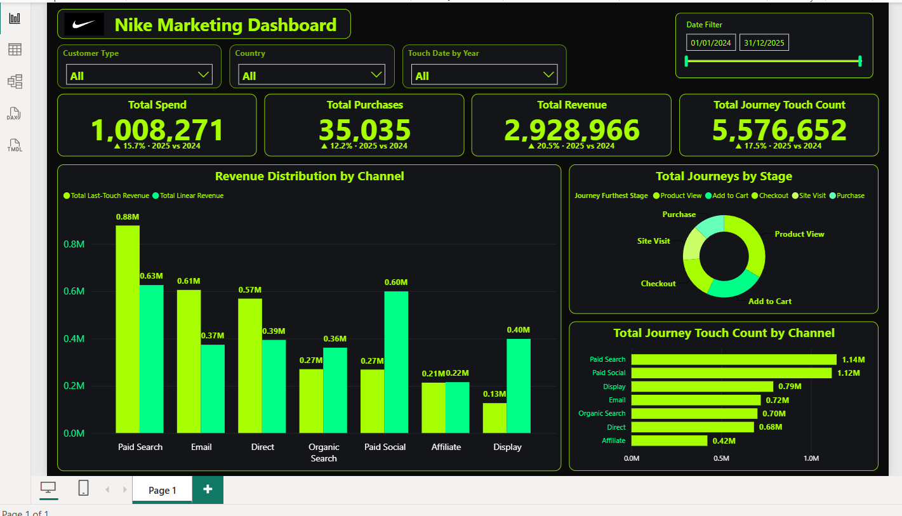

# Nike Marketing Dashboard

## Key Performance Indicators
- **Total Spend:** 1,008,271 (**+15.7%** vs. 2024)
- **Total Purchases:** 35,035 (**+12.2%** vs. 2024)
- **Total Revenue:** 2,928,966 (**+20.5%** vs. 2024)
- **Journey Touch Count:** 5,576,652 (**+17.5%** vs. 2024)

## Business Problems Solved
- Consolidates marketing spend, purchases, revenue and customer journey activity in one dashboard.
- Compares last-touch and linear revenue across marketing channels.
- Highlights how customer journeys progress across funnel stages.
- Identifies channels generating the highest journey touch counts.
- Enables interactive analysis by customer type, country and date.

**Tool:** Power BI,Excel.
